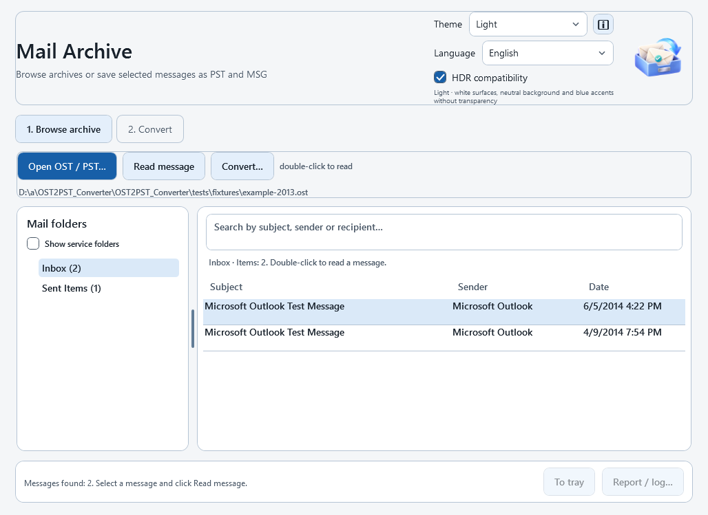
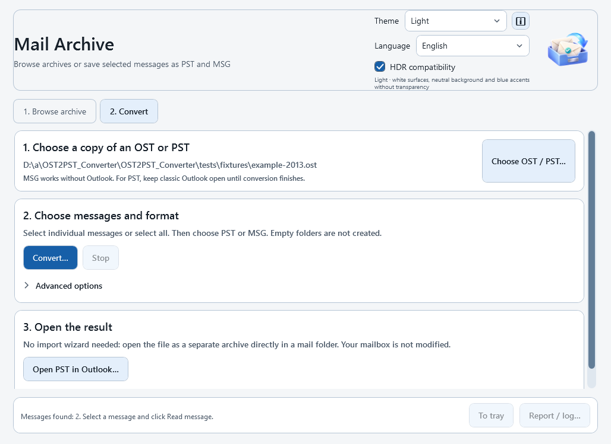

# Mail Archive 1.7.0 — OST / PST / MSG

[Русский](README.md) · **English**

A free Windows application for browsing OST/PST archives and exporting selected messages to a new PST or individual Unicode MSG files.

**MSG export and archive browsing do not require Outlook. PST export requires classic Outlook with a configured profile.** New Outlook does not provide the required COM interface. Formatted message preview requires the free Microsoft Edge WebView2 Runtime.

Download the ready-to-run EXE from [GitHub Releases](https://github.com/ctaniclab/OST2PST_Converter/releases).
Choose **MailArchive-1.7.0.exe**, not the “Source code” archives. No extraction or separate .NET installation is required.
Releases include SHA256 and Defender reports. Version 1.0.1 was detected by Defender; that detection has not been declared a false positive. Do not disable protection or add an exception if a download is blocked.

## What's new in 1.7.0

- **Notification area:** click **To tray**, minimize, or close the window during conversion to keep the conversion running in the background. Use **Stop** to cancel. Click the tray icon to restore the window.
- **Hover preview:** hover over the icon near the Windows clock to see the progress bar, percentage, elapsed/remaining time and counters. The final result remains available after completion. Windows may show a completion notification if notifications are enabled. If Windows hides the icon, open the hidden-icons menu near the clock.
- **Russian / English:** choose a language in the header, then restart the application. The current conversion is not interrupted. Message content, addresses, paths and original folder names are never translated. External library/Outlook diagnostics may remain in the component's language; technical MAPI property names retain their original names.
- **Distinct themes:** Light now has neutral white surfaces. The previous warm style is available as Paper. Graphite uses neutral grays, while Space has new planetary artwork, orbital lines and amber accents.
- Progress also appears on the taskbar button. The tray card is positioned near the cursor within the monitor work area.

## Screenshots

Actual Windows build screenshots using a public test archive and the English interface. Folder names and messages retain their original language.




## Browse an archive

1. Make a local copy of the OST/PST while Outlook is closed.
2. Open **Browse archive → Open OST / PST…**.
3. Choose a folder on the left. By default, the tree shows populated mail folders and necessary parent folders. Cached zero counts do not hide locally readable mail, including IMAP folders. Enable **Show service folders** to inspect additional branches.
4. Select a message and click **Read message**, double-click it, or press Enter.
5. The reader provides formatted content, plain text, source HTML, properties, recipients, dates and file attachments. **Convert this message…** opens the selection wizard with that message selected.

The source is opened read-only and is protected against concurrent writes. HTML preview disables scripts, remote resources and link navigation. Available CID images are embedded locally; oversized or unsupported images are replaced with a label. Attachments are not launched automatically.

If HTML preview is unavailable, use **Text** or install the official [WebView2 Runtime](https://developer.microsoft.com/microsoft-edge/webview2/).

## Select messages and export

1. Click **Convert…** in the browser or conversion tab.
2. Check individual messages or use **Select all**. Search by subject, sender or folder. **Select matching** adds current search results; **Clear selection** clears the whole selection.
3. Click **Next: choose format**, then choose **PST** or **MSG**.
4. Choose a new PST filename or a parent directory for MSG files.
5. Open the result using **Open PST in Outlook…** or **Open MSG folder…**.

MSG export creates a new directory named after the source archive. Existing names receive a `(2)`, `(3)`, etc. suffix. Original folder nesting is preserved, for example `archive/Inbox/Work/message.msg`. Filenames include identifiers so identical subjects do not overwrite each other. Invalid Windows characters are replaced; conflicting names receive suffixes rather than merging folders.

PST mail folders are placed directly below the output archive root. There is no extra “Transferred mail” wrapper. Empty folders are omitted; Outlook's standard PST folders may remain. The Outlook import wizard is not required: open the PST as a separate data file.

Contacts, calendar items, tasks, S/MIME, embedded MAPI messages, OLE and linked attachments are not converted; reasons appear in the report. A regular attached `.msg` file remains a file attachment. Known service/synchronization branches are excluded by default and can be included in advanced options.

## Verification, dates and partial results

MSG files are written directly in Unicode MS-OXMSG format without creating an Outlook compose item, calling Save/SaveAs, or setting properties on account-bound messages. PST export opens the prepared MSG and moves it into the new PST. The returned EntryID, parent folder and StoreID are checked before reopening and verifying the saved item.

Verification checks the subject, preservation of text characters in order (allowing Word whitespace/list formatting), recipient addresses and To/Cc/Bcc roles, original sender address, original dates and attachment SHA256 hashes. PST folder counts are also checked. This does not guarantee every MAPI property, category, flag, signature, rule or exact RTF/HTML layout.

Original sent/received dates are stored in UTC before Outlook opens the MSG; read-back differences cause a verification failure. Missing source dates cannot be reconstructed. Older exports with incorrect dates or blank messages must be recreated from the original archive.

If a newly moved PST item fails verification, the application attempts to isolate that exact item in an `Unverified-…` folder inside the output PST. It never deletes existing account messages. The result remains partial. If isolation fails, for example because Outlook disconnected, the unverified item may remain in its original output folder; review the report before relying on that PST.

A durable `*.conversion.json.jsonl` journal is created beside the result before processing starts. Each message's start and outcome are flushed to disk. The final `*.conversion.json` report is written on normal completion, cancellation or handled failure. After a crash, the journal retains the records already written.

**Automatic resume is not supported.** `MessageStarted` without `MessageFinished` means the last item's outcome is uncertain. Do not blindly repeat imports into the same PST. Existing outputs are not overwritten.

Keep classic Outlook open throughout PST conversion. Known COM disconnection errors stop processing and retain the partial output/report. MSG export is independent of Outlook. Existing messages left in the primary account by older versions are not automatically removed.

The report identifies skipped items, failures, processing stages and HRESULTs. Reports can contain local paths and subjects; remove personal information before sharing them. The application does not send your email anywhere.

## Progress and large archives

The percentage uses the selected message count. The remaining-time estimate excludes startup and adapts after initial messages. During long stalls it says the estimate is being recalculated. Final verification is shown at 99%; 100% is only used for successful completion.

Selection loading can be cancelled by closing the wizard. Cancellation is checked between folders/messages; an individual folder-table read cannot be interrupted halfway through. Full folder paths distinguish similarly named folders.

Search waits for a 300 ms typing pause. The full list still loads into memory and filtering runs on the UI thread, so very large folders can still cause a delay. Disk speed, attachments, Outlook and durable journal writes affect export performance; no benchmark on your Outlook installation is claimed.

## Themes and HDR

Thirteen themes are available: System, Light, Dark, Classic, Liquid Glass, Transparent, Space, Ocean, Aurora, Neon, Terminal, Paper and Graphite. They differ in palette, geometry, typography and original vector artwork. No third-party theme assets or CSS are bundled.

Liquid Glass uses light translucent surfaces and Windows blur. Transparent uses dark tinted surfaces. Native Desktop Acrylic requires Windows 11 22H2+ with transparency enabled. If Windows does not support or allow the effect, the application uses an opaque fallback and explains why. Windows can simplify the material for inactive windows or power saving. Glass effects can be disabled independently of HDR compatibility.

The rounded scrollbars support dragging, page scrolling and the wheel. **Light message background** helps with HTML messages that specify their own colors.

**HDR compatibility** enables software rendering, sRGB preview and grayscale text antialiasing. This is an SDR compatibility mode, not native HDR rendering. Windows display settings are not changed. Restart the message reader after changing browser rendering mode. Physical HDR hardware has not been tested on CI.

The selected application icon is embedded in the EXE and windows. Bundled licenses are available through **ℹ** even in the standalone EXE. Theme references and implementation notes: [THEMES.md](docs/THEMES.md).

## Development and validation

Requires .NET SDK 8. From the repository root in PowerShell:

```powershell
.\tests\Get-Fixtures.ps1
dotnet run --project tests/MailArchive.Checks -c Release -- tests/fixtures/example-2013.ost tests/fixtures/dist-list.pst
.\Build.ps1
```

The standalone EXE is `dist/win-x64/MailArchive.exe`; the package with license files is `dist/MailArchive-win-x64.zip`. Compilation and portable checks work on Linux; WPF and Outlook automation require Windows.

The suite includes 174 portable checks and six MSG files independently read using extract-msg. Windows CI runs the packaged EXE to check browsing, HTML, all themes, the native tray icon, hover-card rendering, restoration and both interface languages. It also creates the README screenshots and scans the executable with Defender. Automated tray checks invoke the hover handler; real mouse hover, Explorer restart and mixed-DPI multi-monitor behavior still need manual checks.

Run the packaged UI checks without Outlook:

```powershell
.\dist\win-x64\MailArchive.exe --self-check-output "$env:TEMP\mailarchive-check.json" --fixture tests/fixtures/example-2013.ost
```

A separate integration harness performs three passes covering complete PST, one-message PST, selected-message PST and MSG outputs, independently reads PST content and checks the source hash and primary-account folder item IDs:

```powershell
dotnet run --project tests/MailArchive.WindowsChecks -c Release -- tests/fixtures/example-2013.ost "$env:TEMP\MailArchive-check-$([guid]::NewGuid()).pst"
```

**Hosted CI has no configured classic Outlook profile. That harness is compiled, not executed there. Real PST conversion, isolation and absence of account-side effects are not claimed to have been verified on actual Outlook.** Use a separate inactive test profile and public fixtures when running it manually.

Additional verification details (Russian): [VERIFICATION.md](VERIFICATION.md). Third-party notices: [THIRD-PARTY-NOTICES.md](THIRD-PARTY-NOTICES.md).
